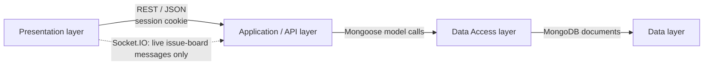

# Layer connection guide

## 1. Presentation → Application / API

Use native `fetch()` with `credentials: "include"` for all persistence requests. The browser sends and receives the `connect.sid` session cookie.

| Presentation module | API destination | Transport |
| --- | --- | --- |
| Login / sign-up | Authentication routes | REST / JSON |
| Dashboard, project chooser, Scrum, Kanban | `/projects/kanban`, `/projects/scrum` and board/card controllers | REST / JSON |
| TDD workspace | `/test/scrum`, `/test/kanban` | REST / JSON |
| Live issue board | `/message` | REST / JSON + Socket.IO broadcast |
| PDF upload / download | `/pdf` | REST / multipart upload or download |
| Reports | Existing board and sprint REST responses | REST / JSON; calculated in React |

## 2. Application / API → Data Access

Route handlers and controllers call Mongoose models from `api/modules/`. React does not access Mongoose or MongoDB directly.

| API service | Mongoose model(s) |
| --- | --- |
| Identity and authorization | `Member`, `KanbanProject`, `ScrumProject` |
| Project, Scrum, and Kanban workflows | `KanbanProject`, `ScrumProject`, `KanbanBoard`, `ScrumBoard`, `DailyScrum` |
| TDD management | `TestCase` |
| Live issue board | `Question`, `Message` |
| PDF management | `PDF` |

## 3. Data Access → Data

Mongoose reads and writes the `student` database on MongoDB `localhost:27017`.

| Mongoose model | MongoDB collection | Stored content |
| --- | --- | --- |
| `Member` | `members` | Users and bcrypt password hashes |
| `KanbanProject`, `ScrumProject` | `kanbanprojects`, `scrumprojects` | Project members and `members[].role` |
| `KanbanBoard`, `ScrumBoard` | `kanbanboards`, `scrumboards` | Embedded cards, tasks, tags, dependencies, and sprint fields |
| `DailyScrum` | `dailyscrums` | Daily Scrum and Sprint Review records |
| `TestCase` | `testcases` | TDD test cases per task |
| `Question`, `Message` | `questions`, `messages` | Issue-board posts and replies |
| `PDF` | `pdfs` | PDF metadata; the actual file is in `api/uploads/` |

## Assembly order

Present the diagrams in this order: `01-presentation-layer.mmd` → `02-application-api-layer.mmd` → `03-data-access-layer.mmd` → `04-data-layer.mmd`. Keep the diagrams separate; use this guide's linear overview only when one end-to-end connection view is needed.
