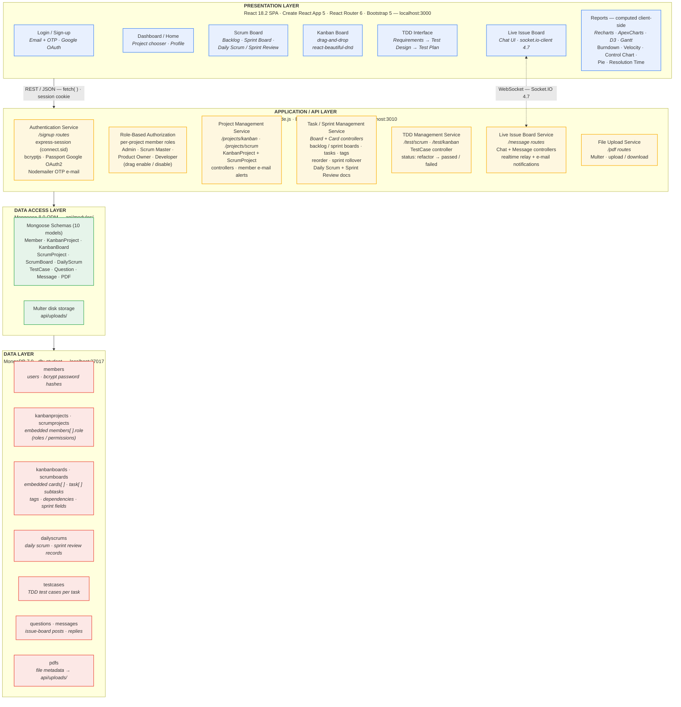

# System Architecture

The application is a two-tier web system — a **React SPA** (`project_management/`, port 3000) talking to a **Node.js/Express REST + WebSocket API** (`api/`, port 3010) — over **MongoDB**. Logically it is organized into four layers: Presentation, Application/API, Data Access, and Data. The diagram below shows the **actual implemented technologies, modules, and collections** of this repository, not generic component names.

## Layer-by-Layer Technology Map

| Layer | Component | Technology / Version | Code Location |
|---|---|---|---|
| Presentation | SPA framework | React 18.2 · Create React App (react-scripts) 5.0.1 | `project_management/src/` |
| Presentation | Routing / UI | React Router DOM 6.21 · Bootstrap 5.3 · react-bootstrap 2.9 | `project_management/src/App.jsx` |
| Presentation | Kanban drag-and-drop | react-beautiful-dnd 13.1 | `src/components/project/kanban/board/` |
| Presentation | Reports (client-side) | Recharts 2.11 · ApexCharts 3.45 · D3 7.8 · gantt-task-react / frappe-gantt | `src/components/project/*/reports/`, `Report/` |
| Presentation | Rich text (daily scrum) | Jodit React 4.0 | `src/components/project/scrum/scrum_review/` |
| Presentation | Realtime client | socket.io-client 4.7.5 | `src/components/project/kanban/Chatting/` |
| Presentation ↔ API | HTTP transport | native `fetch` with `credentials: include` (no axios) | throughout components |
| Application / API | HTTP framework | Node.js · Express 4.18.2 (port 3010) | `api/index.js` |
| Application / API | Authentication | express-session 1.17 (`connect.sid` cookie) · bcryptjs 2.4 · Passport 0.7 + passport-google-oauth2 · Nodemailer 6.9 (OTP) | `api/routes/memberRoute/Signup/` |
| Application / API | Authorization | per-project role strings (`members[].role`) + role lookup endpoint; Kanban `drag` enable/disable | `KanbanProjectController.js`, `findmemberbyId.js` |
| Application / API | Project management | `/projects/kanban`, `/projects/scrum` route modules | `api/routes/kanbanRoute/`, `api/routes/scrumRoute/` |
| Application / API | Task / sprint management | Board, Card, Sprint, and Review controllers (embedded subdocuments, reorder, sprint rollover) | `api/routes/*/` — `BoardController.js`, `ScrumBoardCardController.js`, `ScrumReviewController.js` |
| Application / API | TDD management | `/test/scrum`, `/test/kanban` — test cases per task with status lifecycle | `api/routes/testRoute/TestRoute.js` |
| Application / API | Live issue board | `/message` routes + Socket.IO 4.7.5 realtime relay + e-mail notifications | `api/routes/messageRoute/`, `api/index.js` (io) |
| Application / API | File upload | Multer 1.4 disk storage → `api/uploads/` | `api/routes/pdfRoutes/pdfRoutes.js` |
| Data Access | ODM | Mongoose 8.0.3 — 10 schema models | `api/modules/*.js` |
| Data | Database | MongoDB 7.0 (Community), db `student` @ localhost:27017 | connection in `api/server.js` |
| Data | Collections | `members`, `kanbanprojects`, `scrumprojects`, `kanbanboards`, `scrumboards`, `dailyscrums`, `testcases`, `questions`, `messages`, `pdfs` | auto-pluralized by Mongoose |
| Data | File store | `api/uploads/` on disk (PDFs referenced from cards) | `api/uploads/` |

## Implementation Notes

- **Reporting has no backend service.** Burndown, velocity, control-chart, pie, resolution-time, and Gantt reports are computed in the React layer from board/sprint REST data — hence "Reports" sits in the Presentation Layer, and there is no report collection in the database (report *source* records are the sprint boards and `dailyscrums`).
- **Denormalized document model.** Tasks/subtasks, tags, and card members are embedded subdocuments inside board documents (`cards[].task[]`), not separate collections; likewise roles/permissions live inside each project's `members[]` array rather than a dedicated roles collection.
- **Two authentication paths.** Email + password (bcrypt) with OTP e-mail verification, and Google OAuth2 — both resolve to an `express-session` server-side session.
- **Hybrid transport.** All persistence goes through REST; Socket.IO is used only to broadcast live issue-board messages/edits to other participants in real time.
